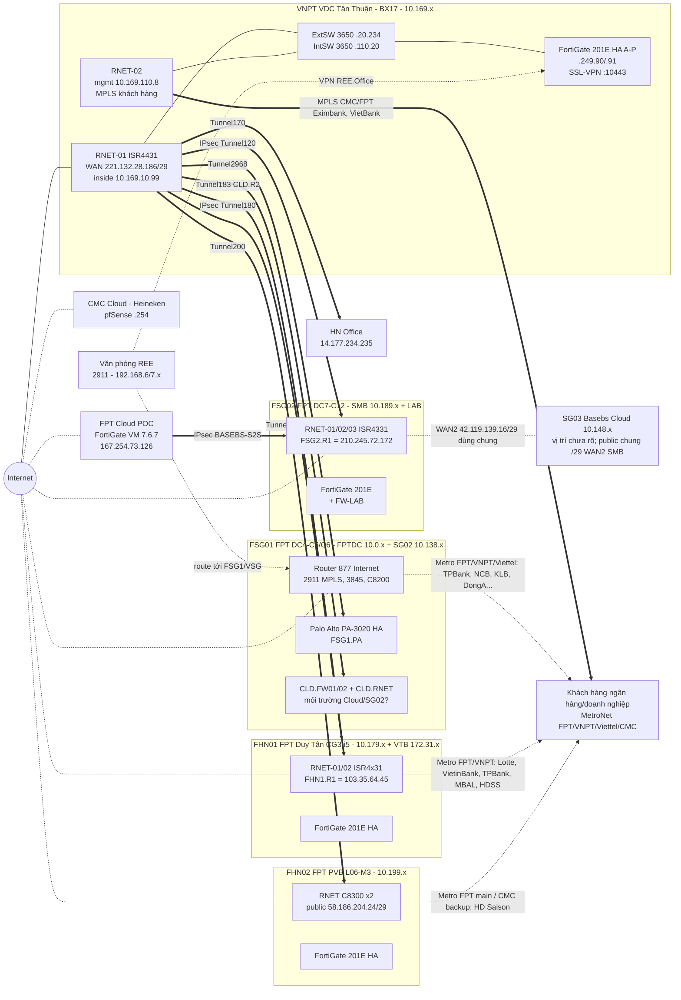
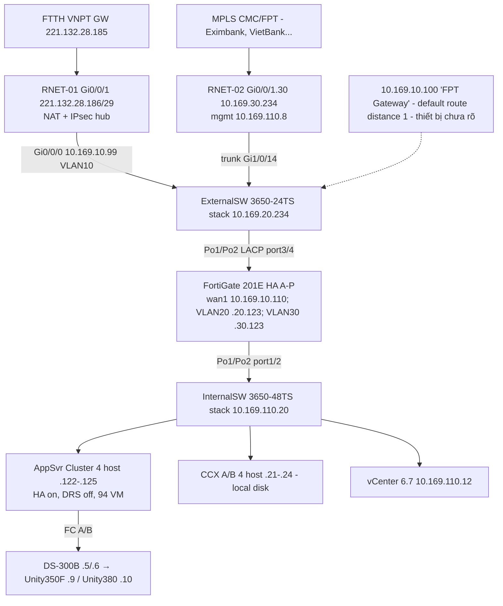
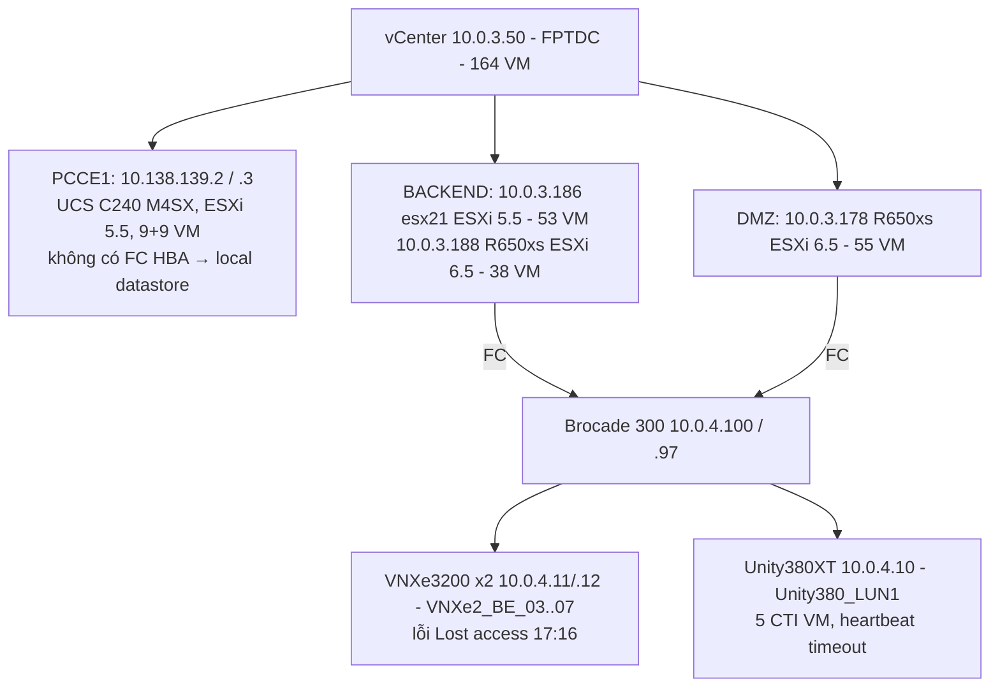

# BaseBS — Tổng quan hạ tầng (Master Overview)

> [!info] Cách đọc
> - **Nhãn độ tin cậy**
>   - `[2N]`: đã xác minh từ ≥2 nguồn độc lập. Bằng chứng live (CLI/PowerCLI/vCenter) được tính là 1 nguồn mạnh.
>   - `[1N]`: chỉ có 1 nguồn.
>   - `[SL]`: suy luận của doc-scribe.
>   - `[VAULT]`: lấy từ note của chủ vault.
> - **Mã nguồn**: `x01…x24` (file Excel đã trích), `CONF` (FortiGate FPT Cloud), `BB` (biên bản FPT 27/08), `BG` (báo giá FPT 07/10), `NOTES`/`BRIEF` (bản tổng hợp cũ 13/11). Bảng ánh xạ ở [[#9. Phụ lục nguồn]].
> - **Bảng IP chi tiết** tách sang [[BaseBS-Infra-Master-Overview-Appendix-IP]].
> - Không có password, license key hay PSK nào trong file này. Credential nằm trong password manager hoặc các sổ gốc (xem §1.3).

Liên kết: [[VDC-VNPT]] · [[FDC-FPT]] · [[VietinBank]] · [[Eximbank]] · [[risk-register]] · [[open-questions]]

---

## 1. Tóm tắt điều hành

### 1.1 Quy mô

| Hạng mục | Giá trị | Nhãn / nguồn |
|---|---|---|
| Data center vật lý | **5 DC** (4 FPT + 1 VNPT). Mã site: **FSG01** = FPT Tân Thuận DC4 (rack C5/C6), **FSG02** = FPT Tân Thuận DC7-C12 (SMB + LAB), **FHN01** = FPT Duy Tân CG3-i5, **FHN02** = FPT Phạm Văn Bạch L06-M3, **VDC/VSG01** = VNPT Tân Thuận BX17 | [2N] x11 StorageLogin (mã site ↔ dải IP) + x05 + x13 rack + BG ("4 DC FPT + 1 DC ngoài") |
| Cloud | CMC Cloud (Heineken AICC; CMC còn là carrier MPLS), FPT Cloud (**POC**: VM ứng dụng chạy được, PCCE3 đã dừng) | [2N] x23 + CONF + NOTES |
| Văn phòng | REE (Đoàn Văn Bơ, Q4, HCM; 192.168.6–7.0/24; Cisco 2911 + C2960X; VPN spoke), HN Office (14.177.234.235; 10.29.30.0/24), VCCI HN (AP) | [2N] x05 + x06 (tunnel REE.Office, route 192.168.5–7.x) / [1N] x03 |
| Thiết bị mạng (DC của FPT) | **49**: 2 SW L2, 14 SW L3, 20 router, 8 FW, 5 thiết bị LAB. Không gồm VDC | [1N] BG trang 2 (danh sách chi tiết) |
| Thiết bị phần cứng cần bảo trì | **92** (server + SAN + network) | [1N] x23 / BG Maintain (chưa đọc chi tiết) |
| ESXi host | **36** host có trong ServerLogin, cộng 2 host SMB (.23/.24) chỉ có trong DeviceList → **~38** | [2N] x11 ≡ x17 + x14 + rack x13 |
| vCenter | **7**: 10.0.3.50 (FPTDC, live), 10.138.110.10 vcsa.sg02basebs.com (7.0.3, live screenshot), 10.169.110.12 vcsa.basebs.com (6.7, live), 10.179.110.10, 10.189.110.10, 10.199.110.10, 172.23.90.10 (LAB) | [2N] cho 3 cái live; 6 vCenter có URL `/ui` do **chủ vault xác nhận 2026-11-24** (xem bảng SSO domain bên dưới); 10.0.3.50 vẫn là [2N] từ x01 |

**vCenter ↔ SSO domain ↔ phạm vi** (chủ vault xác nhận 2026-11-24, không ghi credential; tài khoản nằm trong password manager):

| vCenter | SSO domain | Phạm vi / site |
|---|---|---|
| 10.169.110.12 | basebs.com (có thêm tài khoản thuộc domain connect247.vn) | Hosted VDC ([[VDC-VNPT]]) |
| 10.138.110.10 | sg02basebs.com | SG02 + SG03 ([[FSG01]]) |
| 10.189.110.10 | smbbasebs.com | SMB / CN247 ([[FSG02]]). Xác nhận đây là vCenter, giải quyết K14 |
| 172.23.90.10 | labbasebs.com | LAB ([[FSG02]]) |
| 10.179.110.10 | ccxbasebs.com | PCCE3 / CCX ([[FHN01]] Duy Tân) |
| 10.199.110.10 | hn02basebs.com | Phạm Văn Bạch ([[FHN02]]) |
| 10.0.3.50 | (chưa rõ) | FPTDC ([[FSG01]]). Chủ vault chưa liệt kê; cần xác nhận còn dùng không |
| VM | **VDC: 107** (live 21/11). **FPTDC: 164** (live 22/11; 5 host). Các site khác không có export vCenter; chỉ có sổ VM theo sheet, ~900 dòng IP (§3) | [2N] x06, x01 / [1N] x18 |
| SAN array | **8**: VNXe3200 ×2 + Unity380XT (FSG01), Unity350F + Unity380 (VDC), Unity300 (FHN01), Unity380 (FSG02-SMB), Unity380 (FHN02). Tổng raw ≈ 525 TB (§3.x) | [2N] x14 Storage Info + x13 rack + x17 |
| SAN switch | 10 (2 mỗi DC): Brocade 300 / Connectrix DS-300B / DS-6505B / G620 | [2N] x05 + rack x13 + StorageLogin |
| Khách hàng nhận diện được | ~35 tên (ngân hàng, tài chính, bán lẻ, logistics). Xem §4 | x05, x06, x03, x18, x01 |
| Bản ghi "145 MGMT IP" | Đúng 145 dòng trong sheet MGMT_IP (x07 ≡ x19). Nhưng **không phải** 145 thiết bị: có dòng trùng IP, có dòng BMC, và **thiếu toàn bộ 7 vCenter**, RNET-02 VDC, router/FW/switch PVB | [2N] x07/x19 so với x11/x06 |

### 1.2 Rủi ro lớn nhất

1. **Sự cố 11–12/11/2026 chưa chốt RCA.**
   - Diễn biến: 3 ESXi FPTDC (.186/.188/.178) cùng mất LUN VNXe2 lúc 17:16. Unity380_LUN1 (chứa **5 CTI VM**) bị heartbeat timeout. Host **10.0.3.186** (ESXi **5.5**, UCS C240 M4S, 53 VM) Not Responding, rồi reboot lúc 20:43 không rõ nguyên nhân. 5 CTI được bật lại lúc 00:12 ngày 12/11.
   - Chưa xác định được lỗi ở array VNXe2 hay ở FC fabric. SEL của host đã đầy từ 2021 nên không có log phần cứng. [2N] x01 (log live) + NOTES/BRIEF (nhưng NOTES gán **sai host**, xem §7).
2. **Nền tảng EOL/EOS.**
   - ESXi 5.5 (PCCE1 + BACKEND .186), 6.0/6.5 (VDC, Duy Tân, SMB); vCenter 6.7.
   - Cisco 3650/3850 uptime khoảng 9 năm. Firewall PA-3020 mua năm 2015.
   - **Toàn bộ 8 firewall đã hết license subscription** (không còn IPS/AV); mọi thiết bị đã hết bảo hành hãng. [2N] x11 + x06 + x23 + BG.
3. **Backup không có bản ngoài site và chưa từng test restore.**
   - Job backup chỉ ghi sang NAS/NFS **cùng site**, retention 3–7 ngày, một số job ghi "Not YET".
   - Không có bằng chứng restore. VDC có 2 thiết bị QNAP iSCSI ở trạng thái Dead. [2N] x08 + x06.
4. **Dung lượng và single point of failure của storage.**
   - VDC Unity380_Datastore1 đã dùng 84%.
   - Unity300 Duy Tân hỏng đĩa liên tục 2024–2025; slot 12 hỏng từ 03/2025 mà chưa có đĩa thay.
   - Linh kiện EMC (đĩa định dạng 520-byte, BBU) rất hiếm. [2N] x06 + x14 + x23.
5. **Bề mặt tấn công.**
   - SSL-VPN 221.132.28.186:10443 và IPsec .188 public, terminate trên FortiGate VDC.
   - FortiGate VDC có 39 policy service ALL/accept.
   - FPT Cloud (POC):
     - Expose RDP qua port 13389 tới JumpHost (allow từ một IP "Temp").
     - Expose APISIX 80/443 cho mọi nguồn.
     - Có policy "MGMT-to-Internet all/all".
   - Trunk nội bộ VDC allow VLAN 1–4094. [2N] x06 + CONF.
6. **Dữ liệu cấu hình lệch thực tế.**
   - Duy nhất VDC có review live. Các DC FPT chỉ có inventory 2023–2025.
   - Bản tổng hợp x05 chứa nhiều IP **bịa hoặc lệch**: RNET dùng IP trùng ESXi, VoiceGW .110.31–34 không khớp DeviceList.
   - Dùng x05 để thao tác là nguy hiểm. [2N] (§7).
7. **Secret lộ ở chỗ bất ngờ** (xem §1.3).
   - Đã xử lý ngày 2026-11-24 theo [[2026-11-24-quarantine-credential-files]]: 12 sổ mật khẩu được chuyển ra **ngoài vault**, `.gitignore` đã loại trừ `00-Inbox/` và các mẫu tên credential.
   - **Còn mở:** rotate các credential đã lộ (RemoteGW, enable secret, SAN 10.199.110.9, 6 tài khoản vCenter + connect247.vn đã bị dán vào chat), rồi import vào password manager.

### 1.3 Secret phát hiện ở vị trí bất thường (không ghi giá trị)

> Trạng thái chung cho mọi dòng dưới đây, trừ khi ghi khác:
> - Đã che trong bản trích (scratchpad).
> - File gốc **đã chuyển ra ngoài vault** (`C:\Users\Dang Tran\Documents\BaseBS-Secrets-Quarantine\`) ngày 2026-11-24 theo [[2026-11-24-quarantine-credential-files]].
> - **Vẫn cần rotate credential**: file đã rời vault, nhưng các secret đã từng nằm plaintext.

| Vị trí (file trích → file gốc) | Loại | Ghi chú |
|---|---|---|
| x03 và x04 `BASE-Passwords.csv`, **ô header** | enable secret | Bản "remove pasword" chưa sạch |
| x11 `StorageLogin` R2 cột C; x17 `Storage` R3 cột C | credential admin SAN 10.199.110.9 | |
| x11 và x17 `ServerLogin` cột M "Assigned License(s)" | VMware license key | |
| x12 `RemoteGW Info` R2–R5 cột C | mật khẩu DB root / Guacamole / LDAP của 4 RemoteGW | **Nghiêm trọng**: cần rotate |
| x13 `Thông Tin` R10 cột E | chuỗi user/password | |
| x10 và x18 `Matrix` R21 cột G | chuỗi password | |
| x18 `FDCHN-VTB-UAT`, `LABTest`, `SMB-UAT` R1 | password viết trong dòng tiêu đề | Bộ che đã xử lý (MASKED-LEAK) |
| x09 `CMC Cloud` R11 | Một ô trong file gốc trùng giá trị với một credential ở file khác | Kiểm tra file gốc. Nếu credential là từ thông thường thì xếp vào nhóm **password yếu**, cần rotate (xem R-007) |
| FPT Cloud config | Đã xóa bản trích chưa che. Bản gốc (`FTP Cloud (1).zip`) đã chuyển vào quarantine ngoài vault | |

---

## 2. Sơ đồ kết nối

### 2.1 Tổng thể (WAN / VPN / cloud)

Nét liền là quan hệ có bằng chứng CLI/config. Nét đứt là inventory hoặc suy luận.

> [!note] Kết luận về inter-DC [2N]
> - **Không có MetroNet DC↔DC nào được chứng minh.**
> - Liên kết DC↔DC thể hiện trong cấu hình là **IPsec qua Internet**, đặt trên RNET-01 VDC: có tunnel tới FSG2.R1, FHN1.R1/R2, FHN2.R1, FSG1.PA, CLD.R2, HN Office và VinBD (x06 sheet 04).
> - Các port-channel "Metro" trên ExtSW (FSG01 Po40/Po42, FHN1 Po24, VDC Po24/Po26, FHN2 MetroCMC) chở **leased line của khách hàng** (x05 sheet 02/03, x06).
> - Điểm cần làm rõ: note [[VietinBank]] nhắc "MetroNet PVB ↔ Duy Tân", nhưng **không file nào có cấu hình** cho đường này. Trên ExtSW FHN1 chỉ thấy "MetroVNPT-Vietin-Main" và "MetroFPT-Vietin-Backup", tức là đường về phía VietinBank chứ không phải giữa hai DC.

### 2.2 VDC (đã review live 18–21/11)

### 2.3 FPTDC (FSG01) và sự cố 11/11

---

## 3. Chi tiết từng site

> Mọi IP quản trị và BMC đầy đủ nằm ở [[BaseBS-Infra-Master-Overview-Appendix-IP]]. Phần dưới chỉ giữ các thông tin chính.

### 3.1 VDC — VNPT Tân Thuận HCM (mã VDC / VSG01), rack BX17 → [[VDC-VNPT]]

**Thông tin site**
- Rack BX17, 42U [2N x13 + x14]. Nguồn A/B: chưa có tài liệu.
- ISP: FTTH VNPT 221.132.28.184/29 (dùng .186/.187/.188). Thêm một default route "FPT Gateway" qua 10.169.10.100 có distance thấp hơn, cần xác minh [1N x06 sheet 10].
- MPLS: CMC và FPT (Eximbank), VNPT Metro (Po24), FPT Metro (Po26 — **chỉ còn 1 member**).
- Ngoài phạm vi báo giá Managed Service của FPT.

**Network**

| Thiết bị | Model | IP mgmt | HA / uplink | Nhãn |
|---|---|---|---|---|
| RNET-01 | ISR4431-SEC | 10.169.10.99 (inside), WAN 221.132.28.186/29 | NAT outside, IPsec hub; Gi0/0/0 → ExtSW Gi1/0/11 (CDP) | [2N] x06 CLI + x14 |
| RNET-02 | ISR (cần xác định model) | **10.169.110.8** (mgmt VRF); Gi0/0/1.30 = 10.169.30.234 | MPLS Eximbank (.2531 CMC, .3258 FPT), Tunnel197/217, IP SLA 196 | [1N] x06 CLI. **DeviceList ghi 10.169.10.101**: mâu thuẫn |
| FortiGate 01 / 02 | FG-201E (serial theo tên file config FG201E4Q17901640) | 10.169.249.90 / .91 | FGCP A-P, group BASE-IDCVNPT; port3/4 → ExtSW, port1/2 → IntSW; **port WAN của FW02 ở trạng thái notconnect** | [2N] x06 + x14 + rack |
| ExternalSW | 2× WS-C3650-24TS-E stack | 10.169.20.234 (VDC-ExternalSW.basebs.com) | Po1/Po2 → FW, Po24 METRO.VNPT, Po26 METRO.FPT | [2N]. IP "trùng" trong DeviceList là do stack dùng chung IP (đã giải quyết) |
| InternalSW | 2× WS-C3650-48TS-L stack, IOS XE 03.06.06E | 10.169.110.20 | Stack Active/Standby; EtherChannel 18/18; trunk 1–4094; NTP off; OutDiscards trên uplink FW | [2N] |
| VoiceGW 01/02/03 | ISR4331-V/K9 | 10.169.70.11/.12/.13 | DMZ VLAN70 | [2N] x14 + rack |
| SAN switch A/B | Connectrix DS-300B 8G | 10.169.110.6 (A) / .5 (B) | Dual fabric; chưa có zoning | [2N] x05 + rack |

**VLAN / gateway** (gateway nằm trên FortiGate; [2N] x06 sheet 07 + 08):

| VLAN | Tên | Subnet | GW |
|---|---|---|---|
| 10 | Internet/RNET | 10.169.10.0/24 | (FG wan1 .110) |
| 20 | FW-External | 10.169.20.0/24 | FG .123 |
| 30 | RNET-NAT (MPLS) | 10.169.30.0/24 | FG .123 |
| 70 | DMZ / VoiceGW | 10.169.70.0/24 | .1 |
| 90 | PUBLIC | 10.169.90.0/24 | .1 |
| 110 | MGT | 10.169.110.0/24 | .1 |
| 120 | SYS | 10.169.120.0/24 | .1 |
| 181 / 182 / 183 / 184 / 185 / 186 / 187 / 188 / 189 / 190 | Ibox / A.CCX / B.CCX / CN247 / LCM / SonyApp / uCRM / Database / WFM / Interaction | 10.169.18x–190.0/24 | .1 |
| 249 | MGT-FW | 10.169.249.0/24 | SVI IntSW .1 |
| 221 / 111 | WAN / Mirror (chỉ L2) | — | — |

**ESXi** ([2N] x11 + x06):

| Host | Model | CPU / RAM | ESXi | Cluster | BMC |
|---|---|---|---|---|---|
| SRV.02 10.169.110.122 | UCS C240 M4S | 2×E5-2650v4 (24c) / 256 GB | 6.0 | AppSvr | 10.169.110.154 |
| SRV.03 .123 | Dell R640 | 2×Gold 5220 (36c) / 383 GB | 6.0 (cert **hết hạn 31/10/2026**; 34 VM) | AppSvr (HA master) | .158 |
| SRV.04 .124 | Dell R640 | 2×Gold 5220 / 383 GB | 6.0 | AppSvr | .159 |
| SRV.01 .125 | Dell R660xs | 2×Gold 6442Y (48c) / 383 GB | 6.7 | AppSvr | .165 |
| A.CCX.01 / .02 .21 / .22 | UCS C240 M4S2 | 1×E5-2680v3 / 64 GB | 6.0 | (folder CCX) | không có |
| B.CCX.01 / .02 .23 / .24 | BE7M-M5-K9 | 1×Gold 6132 / 96 GB | 6.5 | (CCX) | .155 / .156 |

- DeviceList còn ghi "Server App 01 10.169.110.121 (UCS M4S)". Host này không có trong ServerLogin và không thấy trên rack, nhiều khả năng đã gỡ [SL].
- Trong ảnh rack: host .123 **không có nhãn**, và nhãn EXTERNAL-SW-02 xuất hiện 2 lần.

**vCenter**: vcsa.basebs.com 10.169.110.12, 6.7.0 build 24323669. 1 datacenter, 8 host, 107 VM. AppSvr Cluster: HA on, DRS off, 94 VM (91 on). [2N]

**Storage** ([2N] x14 + x06):

| Array | IP | Cấu hình đĩa (raw) | Datastore đã thấy |
|---|---|---|---|
| Unity350F (S/N CKM00172900364, 2017) | 10.169.110.9 | RAID5 10×1.6 TB SSD ≈ 16 TB | (chưa map) |
| Unity380 (CKM01212005591, 2021) | 10.169.110.10 | RAID5 13×1.8 TB + RAID6 9×6 TB + cache 2×400 GB ≈ 77 TB | Unity380_Datastore1 17.68 TB (**84%**), Datastore2 11 TB (58%), Cust_LUN-01 7 TB (72%), Infra_LUN-01 1 TB (67%) |

- QNAP iSCSI ×2: Dead/Error trên host .123.
- WWPN của .123 trùng giữa x06 và x11 HBA (…9b:cd:7a:ed/ee) → [2N].
- 4 host AppSvr dùng HBA Emulex (LPe12000 8G trên .122, LPe32000/36000 trên các host khác). 4 host CCX **không có FC**.

**Dịch vụ / VM chính**
- **Connect247**: LB `cn247-lb01` 10.169.90.56, VIP .58 (Nginx/HAProxy/Keepalived). Upstream CTI 10.169.184.91/.92 (port 8300–8302). App 10.169.184.51/.55, DB 10.169.184.52 và 10.169.188.51, file server .184.57.
- **VietBank**: LCM 185.51–.53, uCRM 187.51/.52, DB 188.62–.64.
- **LCM**: Daikin 182.78/79; Vietcredit 183.35.
- **Nền tảng**: PRTG 10.169.120.52 (NAT public :9443), syslog FG 10.169.120.51:30000, backup share 10.169.120.6. VJA proxy 10.169.90.60 (VIP .11.103 → public 221.132.28.187:443).
- Nguồn: [2N] x06 + x08 + x18 VDC-HCM (68 dòng IP).

### 3.2 FSG01 — FPT Tân Thuận DC4 (rack DC4-C5, DC4-C6) → [[FDC-FPT]]

Site này chứa **hai môi trường quản trị riêng**:
- **FPTDC** (legacy HDSS/PCCE1/Avaya; 10.0.3.x/10.0.4.x/10.138.139/173.x; vCenter 10.0.3.50).
- **SG02** (Cluster01 ESXi 7.0.3; 10.138.110.x; vcsa.sg02basebs.com 10.138.110.10).

Nguồn: [2N] x01 + x11 + rack.

**Network**

| Thiết bị | Model | IP mgmt | Ghi chú | Nhãn |
|---|---|---|---|---|
| Firewall FDC.FW01/02 | **Palo Alto PA-3020 HA A/P** (2015) | 10.0.4.31 / .32 (DeviceList); x05 ghi 10.0.20.230 | Có cáp PA1/PA2 trên BE/DMZ/Ext switch; FPT báo giá 2026 vẫn liệt kê PA-3020 ×2 tại FSG01; kế hoạch thay bằng FG-201E (Q3/2024) **chưa thực hiện**; hết license | [2N] x14 + x03 + x05 + BG |
| CLD.FW01/02 | FortiGate 201E? (rack DC4-C5 U17/U18; 1 nhãn "10.199.24…") | chưa rõ | Cắm vào DMZ switch (E1–E4, WAN1); **không có** trong báo giá FPT | [SL] |
| ExtSW | 2× C9300-24T stack | 192.168.4.1 (DeviceList) / 10.0.20.234 (x05) | Po1/Po2 → PA, Po40 MetroFPT (VLAN 2621–2630), Po42 MetroViettel 3127 | [2N] model / [1N] IP |
| BE switch | 2× C3850-48T stack | 10.0.4.21 | trunk tới PA, ESXi; route host tới PRTG VDC 10.169.120.52 | [2N] |
| DMZ switch | 2× C3850-48T stack | 10.0.4.22 | DMZ + SAN380XT + CLD.FW | [2N] |
| C3850-24T ×2 | (L2) | — | chỉ có trong BG | [1N] |
| Router Internet | Cisco 877 | 192.168.3.1 | x05 ghi "Internet **VNPT PPPoE**" | [2N] |
| Router MPLS | Cisco 2911 | 10.127.129.2 (DeviceList); rack ghi "ROUTER-4331 10.127.109.2" | Hub MetroNET ngân hàng (VCCB, DongA, KLB) | mâu thuẫn |
| Khác | FPT-R3845.01/02, C8200-1N-4T ×2, ROUTER-02, fsg1-net-router-02 | — | | [1N] |
| VoiceGW | C3900-SPE200 ×2 10.138.139.51/.52; Avaya G450 ×6 10.138.173.75/.80/.141/.142/.180/.182; rack còn có b1-gw2 10.138.173.81 và VOICE-GW-04 10.138.70.11 | | | [2N] x14 + rack |
| SAN switch | Brocade 300 8G | 10.0.4.100 (A) / 10.0.4.97 (B) | | [2N] |
| Khác trong rack C6 | "VNPT-CORE-SW-01/02", "LIGHTSMART.01/02" | — | Nhiều khả năng là thiết bị carrier VNPT [SL] | [1N] |

- **VLAN FSG01** (x03 legend, x05):
  - Có ID: 2 DMZ, 3 PCCE, 4 Untrust, 6 Amway-SIPFPT, 8 BE-MGT (10.0.3.252), 10 Backend, 20 DMZ/External-MGT (10.138.20.252), 26 CLD-WAN-FPT, 36 ASA-PaloAlto, 71 FPT-WAN, 104 Management, 110 DMZ-MGT (10.138.110.252), 166, 3491 BVB-SIP-VNPT.
  - P2P khách hàng: 2621–2630 FPT, 3127 Viettel.
  - Nhãn [1N]: VLAN ID chưa có running-config.

**ESXi / vCenter**

| Host | Model | CPU / RAM | ESXi | Cluster / vCenter | VM (22/11) | BMC |
|---|---|---|---|---|---|---|
| 10.138.139.2 | UCS C240 M4SX (FCH2029V26K) | 2×E5-2660v3 / 128 GB | **5.5** | PCCE1 / 10.0.3.50 | 9 | — (uplink redundancy alarm) |
| 10.138.139.3 | UCS C240 M4SX (FCH2029V27K) | idem | 5.5 | PCCE1 | 9 | CIMC 10.0.3.16 |
| 10.0.3.186 esx21 | UCS C240 M4S (FCH2045V0YV theo x01) | 2×E5-2695v4 / 384 GB | **5.5** | BACKEND | 53 | chưa rõ |
| 10.0.3.188 | Dell R650xs | 2×Silver 4314 / 384 GB | 6.5 | BACKEND | 38 | 10.0.4.188 |
| 10.0.3.178 | Dell R650xs | idem | 6.5 | DMZ | 55 | 10.0.4.178 |
| 10.138.110.21 / .22 | Dell R660xs | 2×Gold 6442Y / 384 GB | 7.0.3 | SG02 Cluster01 / 10.138.110.10 | ? | .151 / .152 |
| 10.138.110.23 | Dell R650xs | 2×Gold 5320 / 384 GB | 7.0.3 | idem | ? | .153 |

- PCCE1 **không có FC HBA**: VM chạy trên local RAID (5×300 GB ×4 group).
- Các host BACKEND/DMZ/SG02 có FC Emulex dual-port.
- DeviceList 2023 còn ghi App 01/03/04 ở 10.0.3.184/.186/.172. Storage Info 2023 ghi .188/.186/.172/.178. Lịch sử 2023: đã đưa .176 và .182 xuống LAB [1N x14 Plan].

**Storage** ([2N] x14 Storage Info + rack):

| Array | IP | Raw |
|---|---|---|
| VNXe3200 #1 (FL100153401478, 2015) | 10.0.4.11 | RAID5 39×820 GB ≈ 32 TB |
| VNXe3200 #2 (FL100153401479, 2015) — "VNXe2" trong sự cố | 10.0.4.12 | 22×820 GB + 9×800 GB ≈ 25 TB |
| Unity380XT (CKM01205005035, 2021) | 10.0.4.10 | 17×1.8 TB + 10×6 TB + cache 2×400 GB ≈ 91 TB. Có 2 SSD FAST Cache "đang gắn nhưng không nhận" [1N x14 DiskSpared] |

- AD/DNS:
  - FDCHCM-Prod (HD SAISON): 10.0.3.20 / .47, NTP .47, GW x.x.x.254.
  - SG02: 10.138.120.20 / .21 (sg02basebs.com).
  - RemoteGW sg02 DB ở 10.138.90.25.
- Backup HDSS/NTT/CN247 ghi vào 10.138.180.199 (NFS, cùng site) [1N x08].
- VM: FDCHCM-Prod khoảng 45 dòng IP; SG02 khoảng 52 (sheet "HCM_HDSS_PROD_C247Stand"). Ví dụ: Cn247 App01 10.138.173.114, DB 173.113; LCM HDSS 173.111/110; CRM NTT 173.125/126.

### 3.3 FSG02 — FPT Tân Thuận DC7-C12: SMB / Connect247 Production + LAB

- Public:
  - WAN1 103.39.93.192/28 (RNET-01)
  - WAN2 42.119.139.16/29 (RNET-02, **dùng chung với SG03**)
  - WAN3 43.239.148.240/29 (RNET-03)
  - Nguồn: [2N] x18 Domain + NOTES.
- IP của "FSG2.R1" là **210.245.72.172**: đây là peer của IPsec FPT Cloud và Tunnel120 VDC [2N CONF + x06].
- CoreSW có uplink WAN-FPT, WAN-FPT-02, WAN-Viettel [1N x05 PortMap].

**Network**

| Thiết bị | Model | IP | Ghi chú | Nhãn |
|---|---|---|---|---|
| RNET-01 / 02 (/03) | ISR4331-SEC | 10.189.10.101 / .102 (DeviceList) | BG liệt kê ISR4331 Sec ×2, ISR4331 UC ×2, 2911 ×2. Rack chỉ thấy ROUTER-NET-01. x05 ghi mgmt 10.189.110.21/.22, **trùng IP ESXi**, nên bỏ | [2N] model / IP [1N] |
| FortiGate 01 / 02 | FG-201E | DeviceList: cả 2 đều 10.189.249.90; rack: FIREWALL-01 10.189.110.1 | BG có 2 FG tại FSG02, nhưng rack chỉ có 1 nhãn FW. Giải thích nhiều khả năng: 10.189.110.1 là **SVI gateway VLAN110** trên FG (giống mô hình VDC) | [2N] có 2 FG / [SL] .110.1 = GW |
| CoreSW | 2× C9300-48T stack | 10.189.110.20 | DeviceList ghi switch 02 = 10.189.110.10, **trùng với vCenter SMB** (VI SDK). Stack chỉ có 1 IP nên coi .10 là lỗi inventory | [2N] / [SL] |
| VoiceGW 01 / 02 | ISR4331-V | 10.189.70.11 / .12 | +VGW LAB 10.189.70.13 (2911) | [2N] |
| SAN switch A/B | DS-6505B 16G | 10.189.110.5 / .6 | | [2N] |

**VLAN SMB** (x18 Matrix):

| VLAN | Vai trò | Subnet |
|---|---|---|
| 10 | WAN1 | 10.189.10.0/24 |
| 12 | WAN2 | 10.189.12.0/24 |
| 70 | VoiceGW | 10.189.70.0/24 |
| 90 | DMZ (**thực tế có DB**: 90.51–.94) | 10.189.90.0/24 |
| 110 | MGT | 10.189.110.0/24 |
| 120 | SYS | 10.189.120.0/24 |
| 182 | AppSvr | 10.189.182.0/24 |
| 183 | DMZ-Int | 10.189.183.0/24 |
| 184 | DMZ-Ext | 10.189.184.0/24 |
| 185 | UnifyCRM | 10.189.185.0/24 |
| 186 | Cn247 | 10.189.186.0/24 |
| 187 | IC | 10.189.187.0/24 |
| 188 | LCM | 10.189.188.0/24 |
| 11 / 13 | Loopback NAT | 10.189.11.x, 10.189.13.x |
| 80 | Backup | 10.189.80.6 |

**ESXi**

| Host | Model | CPU / RAM | ESXi | Nhãn |
|---|---|---|---|---|
| 10.189.110.21 / .22 | Dell R740 | 2×Gold 6252 (48c) / 256 GB | 6.5 | [2N] |
| 10.189.110.25 | Dell R650xs | 2×Silver 4314 / 384 GB | 6.5 | [2N] |
| 10.189.110.23 / .24 | Dell R640 | ? | ? | [1N] DeviceList + PortMap (AppSvr.03/.04) + zoning SAN; **không có trong ServerLogin** |

- vCenter: 10.189.110.10 (VI SDK, Cluster-01) [1N]. x01 ghi "reported/verify".
- Storage: Unity380 CKM00200400906 (2019) 10.189.110.9. RAID5 5×1.2 TB + RAID6 15×6 TB + cache 2×400 GB ≈ 96 TB raw [2N].
- AD/DNS: 10.189.120.21 (connect247.vn / smbbasebs.com). RemoteGW connect247.vn ở 10.189.90.22. GitLab 10.189.120.23. Backup: NFS 10.189.120.5 và SMB share 10.189.80.6.
- K8s: CP 10.189.184.71–73, worker 10.189.183.61–63 [1N x18 K8s].

**Dịch vụ** (ProxyMapping 2022 + DevOps backup):
- `portal.connect247.vn` (103.39.93.199 → 10.189.184.50):
  - IC 10.189.187.71 (8080–8114)
  - UCRM 10.189.185.50 và UCRMv2 .185.56
  - Connect247 10.189.186.50
  - LCM 10.189.188.50
  - SSO 10.189.184.55
- CUCM PUB 182.31, SUB 182.32 / 182.39.
- Expressway-C 182.35/.55, Expressway-E 183.25 / 184.26.
- Calabrio SQL 182.38, WebCore 182.37.
- VinHMS: DB 90.52, App 182.51, middle 184.56.
- CRM VJA 185.56.
- Số dòng IP: SMB-Prod khoảng 103, Cn247-Cloud khoảng 50. Nhãn [2N] x18 + x08.

**LAB / UAT** (cùng rack DC7-C12)
- Router-LAB: Cisco 1811, 10.189.13.101 (DeviceList) / "SMB.RNETLAB 172.17.203.1" (x05).
- FW-LAB: FG-201E, 10.189.14.109 (DeviceList). x05 ghi 172.17.203.254, khớp GW UAT 172.17.203.254 trong x18 → **có thể là 2 interface của cùng một FW** [SL].
- Switch-LAB: C3560G-48PS 172.17.203.203.
- ESXi BASELAB:
  - .241 R630
  - .244 UCS M4SX
  - .248 / .249 UCS M4S
  - .252 R640
  - BMC = IP ESXi ±1.
  - Do **vCenter 172.23.90.10 của LAB-Test** quản lý (x11 vNic).
  - DeviceList ghi .246 thay cho .248.
- LAB-Test 172.23.90.0/24 (AD .12, GW .254, labbasebs.com) được publish qua RNET-03 của SMB (WAN3) và có trong selector IPsec FPT Cloud → **SMB-UAT và LAB-Test dùng chung hạ tầng LAB** [2N].
- SMB-UAT khoảng 110 dòng IP; LABTest khoảng 47.

### 3.4 FHN01 — FPT Duy Tân, Hà Nội, rack CG3-i5 (CN247 standby, PCCE3/VietinBank)

**Network**

| Thiết bị | Model | IP | Ghi chú | Nhãn |
|---|---|---|---|---|
| RNET-01 / 02 | ISR4431-SEC (DeviceList) / ISR4331-SEC (BG) | 10.179.10.99 / .101 | Public FHN1.R1 103.35.64.45; NAT 103.35.64.46/.47 qua loopback A-CCX 10.179.11.101/.102 | [2N] (model mâu thuẫn) |
| FortiGate 01 / 02 | FG-201E | 10.179.249.90 / .91 | | [2N] x14 + rack + BG |
| ExtSW | 2× C3850-24T | 10.179.20.234 | Po24 MetroFPT: VLAN 1009 TPBank, 1010 Vinacis, 1018 MBAL, 1082 HDSS. Port Lotte P2P/Metro FPT/VNPT, VietinBank Metro VNPT (main) / FPT (backup), FPT iVoice-HDSS. Default route → FW 10.179.20.123 | [2N] model / [1N] VLAN |
| IntSW | 2× C3850-48T-S stack | 10.179.110.20 | | [2N] |
| VoiceGW | ISR4331-V | 10.179.70.11 / .12; PCCE3-VGW01/02 (rack U43/U47); 172.31.70.11 (DeviceList VGW03) | | [2N] |
| SAN switch | DS-300B 8G | 10.179.110.5 / .6 | | [2N] |

**ESXi** (vCenter 10.179.110.10 [1N]; ESXi 6.5):

| Cluster | Host | Model | CPU / RAM |
|---|---|---|---|
| A-App | .21 | R660xs (rack ghi R650xs) | 2×6442Y / 384 GB |
| A-App | .22 / .23 / .26 | R640 | 2×Gold 5220 / 256–384 GB |
| A-App | .24 | R650xs | 2×Gold 5320 / 384 GB |
| A-App | .25 | R650xs | 2×Silver 4314 / 384 GB |
| PCCE Cluster03 | .45 (PCCE3-A) / .47 (PCCE3-B) | BE7H-M5-K9 | 2×Gold 6132 / 192 GB, local disk |
| A-CCX | .53 | BE7M-M5-K9 (rack ghi BE7H) | 1×6132 / 96 GB |

- DeviceList còn ghi PCCE01/02 10.179.110.51/.52 và CCX02 .54. Các host này không có trong rack và ServerLogin. Theo Plan 2023, host "pcce2-b" (10.179.110.21 cũ) đã chuyển về HCM LAB [2N x14 Plan].
- Đĩa PCCE3-A/B hỏng nhiều lần 2023–2026 (slot 9/12/14/22/5/6/20) [1N x17].

**Storage**: Unity300 CKM00184201856 10.179.110.9 [2N].
- Raw: Storage Info ghi cache 4×400 GB + RAID5 11×1.8 TB + RAID6 15×6 TB ≈ 110 TB. DeviceList chỉ ghi 5×400 GB + 11×1.8 TB.
- Lỗi đĩa: 09/2024, 12/2024, 03/2025 (slot 12 chưa thay).
- x05 ghi "Unity 380": **sai**.

**PCCE3 / VietinBank** (sheet FDCHN-VTB-Prod, khoảng 143 dòng IP):
- PCCE BE7K side A/B, External server, Calabrio, CRM, CTI, LCM, middle app, NLB, Baseportal SSO, Voiceportal, RemoteGW (pcce3basebs.com, DB 172.31.184.56).
- Video call (vcall.connect247.vn 103.35.64.47 → 172.31.183.64), Ibox, SQL witness, Recording, CDP, replicate AW-HDS/Nifi/DB, WFM, Report, uCRM v4.
- DNS PROD 172.31.253.51.
- **VTB UAT** 172.31.245.0/24 (khoảng 52 dòng IP; AD 172.31.245.20, GW .1) được NAT qua loopback A-CCX của FHN01 (103.35.64.46) → **đặt tại Duy Tân** [2N] x18 Domain + x18 nhóm FDCHN.
- Khác: AD CN247 10.179.120.20. FDCHN-Other khoảng 39 dòng IP (Connect247 standby, CUCM, TPBank LCM shared, LOTTE, Monitor, Recording Lotte). Backup TPB LCM ghi vào 10.179.80.5/.6.

### 3.5 FHN02 — FPT Phạm Văn Bạch, Hà Nội, rack L06-M3 (HD SAISON, UCRM Cloud)

| Thiết bị | Model | IP | Nhãn |
|---|---|---|---|
| RNET + VoiceGW | Cisco C8300 (BG: ISR8300-V ×2, ISR8300-SEC ×2) | Router 10.199.10.x (rack); VoiceGW 10.199.70.11 / .12 (rack). x05 ghi .20.241/.242 + mgmt .110.21/22 (**trùng ESXi**), nên bỏ | [2N] model / [1N] IP |
| FortiGate 01 / 02 | FG-201E | 10.199.249.x (rack) | [2N] |
| ExtSW / IntSW | C9300-24T-E / C9200-48T-S stack (BG); x05 ghi C9300L-24UXG / C9200L-48P | 10.199.20.234 / 10.199.110.20 (x05) | [1N] IP |
| SAN switch | Brocade G620 32G | 10.199.110.5 / .6 | [2N] |

- Metro: VLAN 2544 HDSS-MetroCMC-Backup 192.168.100.42/30, VLAN 2067 SIP HDSS-CMC. Route HDSS agent qua FPT Main (track 513) và CMC backup. SIP trunk FPT / CMC / Digitel [1N x05].
- Route 10.69.68.0/24 "VSG.VPN" đi qua FW → nhiều khả năng là pool VPN admin của VDC [SL].
- Public 58.186.204.24/29:
  - .25 dc1-api.basebs.vn → 10.199.184.80
  - .26 portal.basebs.com.vn → .184.85
  - .27 SIP → .184.71 / .70
- ESXi (vCenter 10.199.110.10, cluster AppSvrs, ESXi 7.0.3):
  - .21 / .22 R650xs (2×Gold 5320 / 384 GB)
  - .23 R660xs (2×6442Y / 384 GB)
  - BMC .121–.123
  - Nhãn [2N]. x05 ghi "Host01–08": **sai**.
- Storage: Unity380 CRK00240415710 (2024) 10.199.110.9. RAID6 17×1.8 TB + RAID6 8×6 TB + 4×400 GB ≈ 80 TB raw [2N].
- AD hn02basebs.com 10.199.120.20. RemoteGW DB 10.199.90.25. NAS VM 10.199.110.200.
- VM: HDSS-PROD khoảng 48 dòng IP (Voice portal, Kamailio, Proxy, CUCM, Calabrio, CN247 standalone, Recording); BaseApp khoảng 79 (UCRM Cloud, API GW, Ibox, LCM, SQL witness, Checkmk/Prometheus, SSO, WFM, UCRM v4/v5); Infra 7. Wazuh theo NOTES.

### 3.6 SG03 / Basebs Cloud (10.148.x)

- AD/PDC 10.148.120.20 (sg03basebs.com). Khoảng 34 dòng IP: 182.51–63, 183.51, 184.50–55, 186.51–63, 90.50–61.
- Public: 42.119.139.16 (contactcenter.connect247.vn → 10.148.184.50) và .17 (expressway → .184.55), qua loopback "sg03.LoopInt01/02" 10.148.11.101/.102 trên **RNET-02**.
- Dải 42.119.139.16/29 là WAN2 của SMB → [SL mạnh] SG03 dùng edge SMB/FSG02. Cũng có thể là môi trường "CLD" ở FSG01; cần xác minh (Q84).
- Không có ESXi hay vCenter nào mang dải 10.148 trong ServerLogin.

### 3.7 CMC Cloud — Heineken AICC

- pfSense CE 2.7.0 `ecs-pfsense`, gateway .254 trên 192.168.{70,90,120,182,184,188}.0/24. GUI admin chạy HTTPS :8443 trên 192.168.70.254 [2N x09 + NOTES].
- 11 VM, tất cả Active (x09, bản trích lại 24/11):

| VM / hostname | Vai trò | OS | IP |
|---|---|---|---|
| ecs-aiapp01-52 | AICC App Callbot | Debian 12.8 | 192.168.182.52 |
| ecs-aidb01-52 | AICC Database Callbot | Oracle Linux 8.10 | 192.168.90.52 |
| ecs-proxy01-51 | AICC App Proxy | OL 8.10 | 192.168.184.51 |
| ecs-lcmapp01-51 | BASE LCM Application | Windows Server 2019 | 192.168.188.51 |
| ecs-vportal01-52 | Voiceportal | OL 8.10 | 192.168.188.52 |
| ecs-voicegw01-11 | Voice gateway | Cisco IOS | 192.168.70.11 |
| ecs-ssoapp01-51 | SSO App | Windows Server 2019 | 192.168.182.51 |
| ecs-ssoelastic-61 | SSO Elasticsearch | OL 8.10 | 192.168.182.61 |
| ecs-mongodb01-51 | SSO MongoDB + Redis node 1 | OL 8.10 | 192.168.90.51 |
| (tên bị che, xem §1.3) | Monitoring | OL 8.10 | 192.168.120.55 |
| ecs-pfsense | Firewall / GW | pfSense CE 2.7.0 | 6 interface .254 |

- Mâu thuẫn C07 (CMC DB IP) **đã giải quyết**: bảng chính ghi aidb01 = .90.52, mongodb01 = .90.51. Bản csvraw cũ ghi mongodb01 = .90.52, đây là dữ liệu cũ [2N x09 + BRIEF].
- Chỉ có 1 node Mongo/Redis, 1 DB callbot, 1 pfSense → **không có HA** [SL].
- CMC còn là carrier MPLS cho Eximbank (VDC) và HDSS (FHN02) [2N].

### 3.8 FPT Cloud — POC (KHÔNG phải Production)

Nguồn: CONF + x23.
- FortiGate VM 7.6.7 `BASEBS-FW-FTG`, admin port HTTPS 8443.
- Interface: port1 167.254.73.126/24, port2 MGMT 10.1.0.1/26, port3 peering 10.1.0.65/26.
- VPN:
  - IPsec `BASEBS-S2S` → **210.245.72.172 (FSG2/SMB)**. Remote subnet: 172.23.90.0/24 (LAB) và 10.189.70.0/24 (VoiceGW SMB).
  - Dial-up `VPN_Laptop` pool 10.99.99.100–200. SSL-VPN pool 172.29.29.0/24.
- VIP: 167.254.73.126:13389 → JumpHost 10.1.0.2:3389; :443 / :80 → APISIX 10.60.4.25.
- VPC: BASEBS_CLOUD, BASEBS-PCCE-VPC; subnet POC 10.60.1–7.0/24, 172.30.130.0/24.
- Kết quả POC:
  - PCCE3 trên KVM **dừng** (bộ cài Cisco không tương thích VirtIO).
  - VM ứng dụng chuyển được nhưng phải fix tay (GRUB, VirtIO, gỡ VMware Tools).
  - Hướng chốt: **build mới** (cloud-native).
  - Kênh DC↔Cloud: dùng IPsec S2S; X-Connect L2 không hỗ trợ.
- Đề xuất Managed Service của FPT: khoảng 1,58 tỷ/năm, gồm 49 thiết bị mạng và 92 thiết bị phần cứng; BaseBS tự quản từ hypervisor trở lên [2N x23 + BG + BB].

### 3.9 Bổ sung 24/11: dữ liệu đọc thêm

**a) BG_Maintain (FPT, 07/10/2026): danh sách 92 thiết bị cần bảo trì kèm rack / U / IP / serial** [1N, chất lượng không đồng đều]
- Phạm vi: Duy Tân (25 dòng), PVB (17), DC4-C5 (15), DC4-C6 (14), DC7-C12 (21). **Không có VDC.** Con số 92 có tính cả expansion shelf.
- Dữ liệu dùng được:
  - Serial FG Duy Tân: FG201ETK18901932 / …18903181.
  - Serial FG PVB: …20905049 / …20905355; FG SMB: …19906124; FG LAB: …20903990.
  - PVB: router C8300-SEC 10.199.10.101 / .102, FW 10.199.249.90 / .91, VoiceGW C8300-V 10.199.70.11 / .12.
  - Duy Tân: RNET-02 = **10.179.10.102** (DeviceList ghi .101).
  - DC4-C5: VoiceGW.03 C8200 10.138.173.56, VoiceGW.04 C8200 10.138.70.11.
  - **10.0.3.186 và .188 nằm ở rack DC4-C6** (giải quyết câu hỏi Q9).
- **Lỗi copy-paste rõ ràng trong danh sách** (không dùng được cho các trường này):
  - Serial J8X0C14 / 19X0C14 / 6CF7B74 xuất hiện cho cả host Duy Tân, PVB và SG02. Theo x11 (dữ liệu từ hypervisor), các serial này thuộc PVB .21 / .22 và SG02 .21.
  - Host SMB .21 / .22 ghi "R650XS" kèm serial PVB. Thực tế (x11) là R740, serial C984W23 / C971W23.
  - "INTERNAL-SW-01/02" của SMB ghi model "ROUTER-Cisco-1811".
  - **2 FG trong rack DC4-C5 cùng ghi serial và IP của FW02 PVB (FG201ETK20905355, 10.199.249.91).** Có hai khả năng: FW02 PVB đang nằm vật lý tại DC4-C5, hoặc danh sách sai. Liên quan K13.
- **Thiếu trong danh sách bảo trì:** VNXe3200 #1 10.0.4.11, BE switch 10.0.4.21, PA-3020 (chỉ có trong danh sách MS mạng), BASELAB .241, host SMB .23 / .24.
  - Việc thiếu .23 / .24 củng cố khả năng hai host này **đã gỡ** (K16).
- SMB: 1 dòng "NET.Firewall.01 / NET.Firewall.02" 10.189.110.1, cùng 1 serial → **khả năng cao SMB chỉ có 1 FG vật lý** (K15, [SL]).
- Router MPLS DC4-C5 = **10.127.109.2 Cisco 2911** (BG + rack) → K12 nghiêng về .109.2 [2N].

**b) Q&A Managed Service (x21, BaseBS trả lời FPT)** [1N, nhưng là lời khai trực tiếp của BaseBS]
- **"Network giữa các datacenter chỉ có VPN site-to-site"** → K20 [2N]. Replication hệ thống / dữ liệu giữa hai miền do team System tự cấu hình.
- Firmware: **PAN-OS 7.0, FortiOS 5.6.6, IOS 12.x / 15.x**, đều EOL; firewall hết subscription; chấp nhận vận hành as-is.
- Admin vào qua VPN client-to-site → VLAN management → OOB. Truy cập VM qua jumphost. Chưa có PAM.
- OOB: cổng mgmt cắm về switch management trong rack, không có console server. iDRAC / CIMC license Enterprise / Advanced.
- Giám sát: PRTG; SNMP v2c / v3; syslog.

**c) Backup theo site (x08)** [1N]

| Site | Đích backup | Đối tượng chính |
|---|---|---|
| FSG02 SMB | NFS 10.189.120.5, SMB \\\\10.189.80.6 | CRM / UCRM / IC / LCM / SSO / Cn247 Cloud; CUCM / Expressway qua SFTP `/Sys_BackupCisco` |
| FHN02 PVB | `nassvr.hn02basebs.com` **10.199.80.200** (NAS VM) | HDSS C247s DB, UCRM / LCM / WFM / Ibox; **GitLab SMB 10.189.120.23 cũng backup sang đây** (bản off-site duy nhất thấy được, giữ 2 ngày) |
| FHN01 Duy Tân | 10.179.120.5 (NFS) / 10.179.120.6 (SMB) cho VTB; 10.179.80.5 / .6 cho TPB / Lotte / CN247 | VTB uCRM / LCM / SSO / MID / Ibox / pgBackRest |
| FSG01 | 10.138.180.199 / .200 (FDC.NAS01), `smb.sg02basebs.com` | Cn247 HDSS, LCM HDSS, CRM NTT, C247s SG02 DB |
| VDC | "Tổng hợp" ghi 10.169.120.6; sheet VDC ghi **10.169.120.9**; Intranet → 10.169.120.5 | CN247, LCM VietBank / Daikin / Vietcredit, uCRM VietBank |

- Mâu thuẫn mới **K31**: share backup VDC là 10.169.120.6 hay .9.
- Retention 2–7 ngày. Không thấy job VM-level (Veeam…) nào.

**d) Kiến trúc đích FPT Cloud (Topo-FPT-Cloud-Base.jpg)** [1N, chỉ là thiết kế]
- HO và Branch Office kết nối qua WAN / Direct link tới Transit VPC (Jump host + NGFW).
- Transit VPC peering tới Base-LMC-VPC (subnet LCM / uCRM / SSO, mỗi subnet có LB + 2 app + 3 DB / Elastic / FileShare) và Base-PCCE-VPC. Backup bằng FPT Backup.
- Đối chiếu: PCCE trên cloud **đã dừng** (x23).

**e) VM chính theo site (x18, tên VM tự ghi IP; không ghi account)** [1N]
- **FHN01 (FDCHN-Other)**:
  - PROD_Cn247: App01 / 02 186.51 / .52, FileSvr 186.50, Db01 / 02 90.51 / .52, Interact01–03 186.54–56, Agent01 / 02, LB01 / 02 186.61 / .62, Voice01–03 186.65–67, Autocall01–06 186.71–76, KamaLB01 / 02 184.71 / .72.
  - TPB_LCM App 188.51 / .52, DB 90.81–83, LB 184.82 / .83.
  - LOTTE: Calabrio Recording 182.61, Voicegw 184.81, Asterisk 182.62.
  - BASE_Central_logs 184.41, BASE_Proxy_Mgt 184.42, Recording App / DB / Fw 182.66 / 90.61 / 182.67.
- **FHN02 HDSS-PROD**:
  - HDS_Cn247s App01–03, File 186.50, DB01–03, Interact04–07, Jtapi01 / 02 186.68 / .69, RepDB 184.61, Voiceportal01–05 186.61–63 / .73 / .74, Kamailio master / slave 184.53 / .54 / .71.
  - HDS_Proxy01 / 02 184.51 / .52, CUCM Pub 182.20, Sub 182.21 / .22.
  - Calabrio: Pf01 / 02, DB01 / 02 90.21 / .22, ACDSync, Primary / Secondary, DFS 182.51–57.
  - Recording: App / File / DB / SIPREC / Voiceportal / FS 182.61–65, 90.81 / .82.
- **FHN02 BaseApp (UCRM Cloud)**:
  - UCRM LB 185.51 / .52, App 185.53 / .54, Redis 185.55–57 / .61–63, ELK, DB 90.51–53; UCRMv4 185.56 / .57, DB 90.56–58; uCRMv5 185.90 / DB 90.65.
  - ApiGw 184.81 / .82, Proxy 184.83 / .84, Proxy_Management 184.86.
  - Ibox 181.51 / .52, DB 90.73 / .74; LCM 188.51–55, DB 90.91–93.
  - IC App 187.51 / .52, DB 90.102–105, Int / Agent / ELK 187.53–59.
  - WFM 189.51–54, DB 90.111–113; Interact (180.51–57) và InteractUW (180.61–65).
  - SQL_Witness 90.41, Checkmk 184.42, Centrallog 184.43, Percona 184.44.
- **FSG01 SG02**: HDS_Proxy 138.184.51 / .52, HDS_Cn247s App 186.51 / .52, Fileshare 186.53, DB 90.51 / .52, Interact 186.54–56, Redis 186.57, BASE_WitnessDB 90.20.
  - Cùng mô hình đặt tên với HDS_Cn247s ở PVB → [SL] **HDSS Cn247 standard: active ở PVB, standby ở SG02.**
- **FSG01 FDCHCM-Prod**: PROD_Asterisk01 / 02 HDSS 173.112 / .165, Calabrio DB PC 173.116, Syncdata UCCX247 173.131, Dashboard client-hosted 173.132, HDSS_LCM App02 / Db03 173.227 / .230, HDSS_Nginx02 173.242, NTT uCRM App / DB / ELK 173.125–127.
- **VTB (FHN01)** theo backup x08: uCRM App 172.31.185.51, DB 90.51–53; LCM DB 90.81–83, App 188.81; SSO 184.53 / .54; MID App 182.51; MID + Ibox DB 90.91 / .92; uCRMv4 Report 90.42; pgBackRest 90.44.

---

## 4. Dịch vụ theo khách hàng

Nguồn: x05 cột "đối tác", x06 sheet 12, x03 port, x18, x01, BRIEF. **Không chép dữ liệu cá nhân.** Dải mạng nội bộ của khách hàng chỉ ghi số lượng.

| Khách hàng | Site / hệ thống | IP app (đại diện) | Quản trị / kết nối | Public / FQDN | Nhãn |
|---|---|---|---|---|---|
| **[[VietinBank]]** (VTB) | FHN01: PCCE3 + CRM / CTI / LCM / WFM / uCRM v4 / Recording; UAT 172.31.245.0/24 | 172.31.x (DNS 172.31.253.51) | ESXi .45 / .47; Metro VNPT (main) / FPT (backup); RemoteGW pcce3basebs.com | vcall.connect247.vn 103.35.64.47; uatwebcall 103.35.64.46 | [2N] |
| **VietBank** (+ "BVbank" trong tiêu đề sheet) | VDC: LCM, uCRM, CN247, DB | 10.169.185.51–53, 187.51 / .52, 188.62–64 | 17 route, 9 policy FG; MPLS qua RNET-02 | — | [2N] x06 + x08 + x18. **Khác với VietinBank** |
| **[[Eximbank]]** | VDC: CCX / uCRM / CRM UAT | (41 route, 11 policy) | MPLS CMC (Tunnel197) + FPT (Tunnel217, track 196 có 1215 lần chuyển trạng thái); thiếu route 10.128.133.38 | — | [2N] x06 |
| **HD SAISON (HDSS)** | FHN02 (prod HDSS, Kamailio, Recording) + FSG01 (FDCHCM-Prod, LCM HDSS, CN247 standby SG02) | 10.199.184.x; 10.138.173.110–114 | Metro FPT main / CMC backup; SIP FPT / CMC / Digitel; AD 10.0.3.20 / .47 | dc1-api.basebs.vn, portal.basebs.com.vn | [2N] |
| **VIKKI** (nhiều khả năng = DongA Bank cũ [SL]), **NCB** | FSG01 (PCCE1 / Avaya / CTI) | 10.138.139 / 173.x | Leased line DongA-FPT/VNPT, NCB-FPT VLAN 2625 | — | [2N] BRIEF + x05 / [SL] tên |
| TPBank | FSG01 (VLAN 2627) + FHN01 (VLAN 1009, LCM shared hosted 10.179.188.51 / .52) | | Metro FPT / VNPT | | [1N] x05 + x08 |
| Lotte Finance | FHN01 (route track 351, Recording gateway) | | P2P + Metro FPT / VNPT | | [1N] |
| MB Ageas Life (MBAL), Vinacis, ITY | FHN01 Metro FPT | | | | [1N] |
| KienLongBank, Novaland, VRB, Bảo Việt Bank (FCI bot), Daikin, Amway, InSee, VNTEL, VCCB, THP, DMSPro, JACCS, Thanh Bưởi, VHU | FSG01 leased line / SIP | | ExtSW FSG01 | | [1N] x05 / x03 |
| VietJet (VJA) | VDC: proxy 10.169.90.60 (VIP 221.132.28.187:443, 5349); FSG02: CRM APP VJA 10.189.185.56 | | 9 policy FG VDC | vietjet.connect247.vn (DNS ghi "Remove"); proxy vẫn có trong config 18/11 | [2N] |
| Sony / Hoa Sao, CFC, GHN, Kerry, LaviFood, JioHealth, Savills (VPN), Vietcredit, Namitech | VDC (agent route, VPN, LCM) | 10.169.186.x (SonyApp), 183.35 (Vietcredit LCM) | FG VDC | | [1N] x06 / x05 |
| Heineken | CMC Cloud: AICC callbot (app 182.52, DB 90.52, proxy 184.51), SSO (182.51 / .61, Mongo 90.51), LCM 188.51, Voiceportal 188.52, VoiceGW 70.11, monitoring 120.55 | 192.168.x | pfSense .254 (GUI :8443) | (chưa có dữ liệu ingress) | [2N] x09 + BRIEF |
| NTT | FSG01 CRM NTT 10.138.173.125 / .126 | | | | [1N] x08 |
| VinHMS | FSG02 C247 VinHMS | 10.189.90.52, 182.51, 184.56 | | | [1N] x08 |
| REE (văn phòng BaseBS) | VPN tới VDC | 192.168.5–7.x | | | [2N] |
| Connect247 (SaaS nội bộ) | FSG02 (active) + standby tại FHN01 / FHN02 / SG02 / SG03 / VDC | xem §3 | | portal.connect247.vn 103.39.93.199, contactcenter.connect247.vn 42.119.139.16 | [2N] |

---

## 5. Bảng IP tổng

Bảng đầy đủ (IP quản trị, BMC, VLAN, public NAT) nằm ở [[BaseBS-Infra-Master-Overview-Appendix-IP]]. Tóm tắt quy ước:

| Site | Dải nội bộ | Mgmt | Gateway | AD / DNS | vCenter |
|---|---|---|---|---|---|
| VDC | 10.169.0.0/16 | VLAN110 10.169.110.0/24, FW mgmt 10.169.249.0/24 | FG .1 [2N] | 10.169.120.20 | 10.169.110.12 |
| FSG01 FPTDC | 10.0.3.0/24 (BE / host), 10.0.4.0/24 (infra / SAN), 10.138.139 / 173 / 180.x | 10.0.3.x / 10.0.4.x | x.x.x.254 | 10.0.3.20 / .47 | 10.0.3.50 |
| FSG01 SG02 | 10.138.0.0/16 | 10.138.110.0/24 | ? | 10.138.120.20 / .21 | 10.138.110.10 |
| FSG02 SMB | 10.189.0.0/16 | 10.189.110.0/24 | 10.189.x.1 | 10.189.120.21 | 10.189.110.10 |
| LAB | 172.17.203.0/24, 172.17.184.x, 172.23.90.0/24, 172.23.184.x | — | 172.17.203.254 / 172.23.90.254 | 172.17.203.20 / 172.23.90.12 | 172.23.90.10 |
| FHN01 | 10.179.0.0/16 + 172.31.0.0/16 (VTB) | 10.179.110.0/24 | 10.179.x.1 / 172.31.x.1 | 10.179.120.20; 172.31.253.51; UAT 172.31.245.20 | 10.179.110.10 |
| FHN02 | 10.199.0.0/16 | 10.199.110.0/24 | 10.199.x.1 | 10.199.120.20 | 10.199.110.10 |
| SG03 | 10.148.0.0/16 | ? | ? | 10.148.120.20 | ? |
| CMC | 192.168.70–188.0/24 | — | pfSense .254 | — | — |
| FPT Cloud | 10.1.0.0/26, 10.1.0.64/26, 10.60.x, 172.30.x | 10.1.0.0/26 | FGT | — | — |

---

## 6. Phụ thuộc và luồng dịch vụ

Đối chiếu với `02_site_flow_to_validate.svg`, gồm 5 bước: VM route/ARP → SVI/VLAN → FW session/NAT → router/ISP → return/HA.

| Luồng | Đường đi có bằng chứng | Bước SVG đã chứng minh | Còn thiếu |
|---|---|---|---|
| VDC outbound | VM → GW .1 trên FG (SVI) → FG wan1 10.169.10.110 → RNET-01 inside .10.99 → NAT 221.132.28.186 → .185 [2N] | 2, 3 (theo config), 4 (CLI) | Session thực, policy cụ thể; default route "FPT Gateway" .10.100 được ưu tiên hơn nhưng chưa biết thiết bị |
| VDC inbound | 221.132.28.187:443 → RNET-01 NAT → 10.169.11.103 (loopback FG) → VIP → 10.169.90.60; .188:9443 → PRTG; .186:10443 → SSL-VPN FG | 3, 4 | Policy tương ứng; chuỗi NAT 2 tầng |
| VDC ↔ khách MPLS | Khách → carrier → RNET-02 subif → VLAN30 → FG RNET-NAT .30.123 → VLAN dịch vụ [2N] | 2, 3, 4 | Map từng khách → VM |
| Connect247 VDC | Public → LB 10.169.90.56 / VIP .58 → CTI 10.169.184.91 / .92 → DB VLAN188 [2N CLI] | — | Peer keepalived, DB replica |
| SMB portal | 103.39.93.199 → RNET-01 loopback 10.189.11.106 → FG → 10.189.184.50 (reverse proxy) → IC / UCRM / C247 / LCM / SSO theo path [2N] x18 Domain + ProxyMapping | 3 (mapping cũ 2022) | Config hiện tại RNET / FG |
| DC ↔ DC quản trị | IPsec RNET-01 VDC ↔ FSG2 / FHN1 / FHN2 / FSG1.PA / CLD; REE / HN office; FSG01 BE route tới PRTG VDC 10.169.120.52 | 4 (tunnel up trong snapshot) | Selector, routing |
| Voice | PSTN / SIP trunk (FPT iVoice, VNPT, Viettel, CMC, Digitel) → VoiceGW (ISR4331 / C3900 / C8300 / Avaya G450) → CUCM / CCX / PCCE → CTI → CRM / Recording (Calabrio) [1N] | — | Dial plan, SIP peer |
| Backup | VM → NAS / NFS cùng site (10.189.120.5, 10.189.80.6, 10.169.120.6, 10.138.180.199, 10.179.80.5 / .6), 3–7 ngày [1N x08] | — | Bản off-site, test restore |
| Storage | ESXi FC dual HBA → fabric A/B (Brocade / Connectrix) → Unity / VNXe [2N HBA + PortMap] | — | Zoning, LUN map |

---

## 7. Mâu thuẫn giữa các nguồn và sai sót trong bản tổng hợp cũ

### 7.1 Xác định các bản tổng hợp

| Bản | Gồm | Đánh giá |
|---|---|---|
| **Tổng hợp cũ #1 (13/11)** | NOTES.md + BRIEF.pdf + workbook `BASEBS_INFRA_HANDOVER_13-11-2026.xlsx` (x19, trong Handover Pack). `Infra_Handover.xlsx` (x07) **là cùng một file**: 13 sheet giống hệt, số dòng giống, nội dung MGMT_IP giống | Trung bình. Thận trọng, có ghi nguồn, nhưng sai về host bị sự cố, đọc nhầm nhãn rack, bỏ sót host / vCenter |
| **Tổng hợp cũ #2** | `BaseBS_AllDC_Master_Switch_and_Device_Inventory (1).xlsx` (x05) | **Thấp.** Phần port map có giá trị. Bảng tóm tắt và "Edge Routers" chứa nhiều IP **sai hoặc bịa** (chi tiết ở 7.2) |
| Báo cáo VDC 21/11 (x06) + `VNPT_DC_TOPOLOGY…` (x02 ≡ x15, **giống hệt nhau**: 21 shape cùng text, sheet rỗng) | Tổng hợp mới có phân loại bằng chứng (EV01–EV10) | **Cao** cho VDC |

### 7.2 Mâu thuẫn và sai sót

Cột "Nghiêng về" là phương án doc-scribe đề xuất tin theo, kèm lý do.

| # | Nội dung | Nguồn A | Nguồn B | Nghiêng về |
|---|---|---|---|---|
| K1 | **Host bị sự cố 11–12/11** | NOTES / BRIEF: "PCCE1 10.138.139.2 / .3, ~52 VM" | x01 (PowerCLI, vobd log): **10.0.3.186** BACKEND (53 VM); PCCE1 chỉ có 9 + 9 VM | **B** (log live). Con số "52 VM" trùng với .186 |
| K2 | Ngày bắt đầu sự cố | BRIEF: 12/11 | x01: 11/11 17:16; CTI bật lại 12/11 00:12 | B |
| K3 | vCenter 10.0.3.50 | NOTES: chỉ là candidate | x01 live + x11 VI SDK của 5 host | B, **[2N]** |
| K4 | ESXi BASELAB .241 / .249 trùng với FW-LAB / Router-LAB | NOTES đọc rack: "router-LAB .249, firewall-LAB .241" | Ảnh rack: .249 / .241 là **nhãn server riêng**, nằm cạnh ROUTER-LAB / firewall-lab (không có IP); DeviceList: Router-LAB 10.189.13.101, FW-LAB 10.189.14.109 | B. Không có xung đột IP; NOTES đọc nhầm nhãn |
| K5 | IP của RNET / VoiceGW (x05) | x05: RNET mgmt 10.x.110.21 / .22, HSRP .20.240–242; VGW 10.x.110.31–34 | DeviceList / rack / x06 CLI: RNET 10.x.10.99 / .101; VGW 10.x.70.11–13; 10.x.110.21 / .22 là **ESXi** | B. x05 sai |
| K6 | Tên DC VDC | x05: "Viettel Data Center" | Mọi nguồn khác: VNPT | B |
| K7 | Firewall VDC mgmt | x05: 10.169.10.99 | x06 CLI: FG mgmt .249.90; .10.99 là RNET-01 | B |
| K8 | SAN FHN01 | x05: Unity 380 | x14 / rack / x17: Unity300 | B |
| K9 | Số host FHN02 | x05: Host01–08 | x11 / rack: 3 host | B |
| K10 | RNET-02 VDC | DeviceList: Router Internet 02 10.169.10.101 | x06 CLI: RNET-02 mgmt 10.169.110.8, vai trò MPLS | B, nhưng cần làm rõ: có thể .10.101 là interface còn lại |
| K11 | Model router FHN01 | DeviceList: ISR4431-SEC | BG 2026: ISR4331-SEC / -V | Chưa chọn. Cần show version |
| K12 | Router MPLS FSG01 | DeviceList: 2911 10.127.129.2 | Rack: ROUTER-4331 10.127.109.2 | Chưa chọn. Có thể đã thay router |
| K13 | Perimeter FSG01 | NOTES: PA-3020 hay FG chưa rõ | Port map (x03 / x05) + BG 2026: PA-3020 ×2 vẫn đang được bảo trì; Plan 2023 thay FG chưa làm; FG-201E trong rack = CLD.FW [SL] | **PA-3020 là perimeter FDC [2N]** |
| K14 | SMB vCenter 10.189.110.10 và Internal switch 02 | DeviceList: switch 02 = .110.10 | x11 vNic: VI SDK = .110.10; x05: CoreSW là stack .110.20 | **Đã giải quyết: .110.10 là vCenter SMB** (chủ vault xác nhận 2026-11-24; x11). DeviceList ghi sai |
| K15 | Số FW và router tại SMB | DeviceList / BG: 2 FG, 2–3 RNET | Rack DC7-C12: 1 FIREWALL, 1 ROUTER-NET | Chưa chọn. Kiểm tra vật lý |
| K16 | Host SMB | ServerLogin: 3 (.21 / .22 / .25) | DeviceList / PortMap / zoning: 5 (.21–.25) | 5 host vật lý; .23 / .24 có thể đã ra khỏi cluster [SL] |
| K17 | Server LAB | DeviceList: .244 / .246 / .249 / .252 | Storage Info / ServerLogin: .244 / .248 / .249 / .252 (+ .241) | ServerLogin |
| K18 | VTB UAT | NOTES: rack chưa rõ | x18 Domain: NAT qua loopback A-CCX FHN01; sheet thuộc nhóm FDCHN | **Duy Tân [2N]** |
| K19 | SSL-VPN 221.132.28.186 | NOTES: site chưa rõ | x06: WAN RNET-01 VDC, NAT :10443 → FG 10.169.10.110 | **VDC [2N]** |
| K20 | Inter-DC | NOTES / draft: không có bằng chứng; [VAULT] MetroNet PVB ↔ Duy Tân | x06: IPsec RNET-01 VDC tới mọi site; Metro chỉ là leased line của khách | IPsec [2N]. MetroNet PVB ↔ DT **chưa có bằng chứng** |
| K21 | LAB-Test và SMB-UAT "không gộp" | NOTES | x11: vCenter LAB 172.23.90.10 quản lý host 172.17.203.x; Domain: cả hai NAT qua RNET SMB | Chung hạ tầng [2N] |
| K22 | "145 MGMT IP" | BRIEF: 145 bản ghi | x07 / x19: đúng 145 dòng, có trùng IP và BMC; thiếu vCenter / RNET-02 / mạng PVB | Không dùng làm số thiết bị |
| K23 | VDC thiếu ESXi | NOTES | x11 / x06: 8 host | B |
| K24 | Disk Unity300 | DeviceList: 5×400 GB + 11×1.8 TB | Storage Info: 4×400 GB + 11×1.8 TB + 15×6 TB | Storage Info (mới hơn) |
| K25 | Model host | rack: R650XS 10.179.110.21, BE7H 10.179.110.53 | x11: R660xs; BE7M-M5 | x11 (dữ liệu từ hypervisor) |
| K26 | PVB "DeviceList không có PVB" | NOTES | x14 Storage Info có FHN02 (bổ sung 2024) | Sheet Storage Info |
| K27 | Uplink vSwitch .186 | x11 inventory: vSwitch1 vmnic6, vSwitch2 vmnic4 | x01 live 22/11: vmnic7 / vmnic3 | Live. Đã có thay đổi không rõ ai làm |
| K28 | x10 và x18 (NoiBo1-Infra-Credential) | x10: FDCHN-VTB-Prod 186 dòng | x18 (thư mục Infra\): 185 dòng, thứ tự sheet khác | x18 bản mới. Chưa diff từng ô |
| K29 | x11 và x17 | Hardware Credentials | Passwork-System Infra | ServerLogin **giống hệt**. x17 có thêm StorageInfo mới hơn (04/2025–07/2026); x11 có HBA / vNic |
| K31 | Share backup VDC | x08 Tổng hợp: 10.169.120.6 | x08 sheet VDC-HCM: 10.169.120.9 | Chưa chọn |
| K32 | Serial / model trong BG_Maintain | BG: J8X0C14 / 19X0C14 / 6CF7B74 gán cho Duy Tân, PVB và SG02; SMB .21 / .22 ghi R650XS | x11: mỗi serial chỉ thuộc 1 host; SMB .21 / .22 là R740 | x11. BG có lỗi copy-paste |
| K33 | FG trong DC4-C5 | Rack: FG "10.199.24…" | BG: 2 FG ở DC4-C5 cùng serial / IP với FW02 PVB (10.199.249.91) | Chưa chọn. Cần kiểm tra vật lý: có thể FW02 PVB đặt nhầm site, hoặc dữ liệu sai |
| — | Cập nhật 24/11 cho các K cũ | **K12** → 10.127.109.2 [2N rack + BG]. **K15** → SMB nhiều khả năng chỉ có 1 FG vật lý [SL]. **K16** → .23 / .24 không có trong BG, củng cố "đã gỡ". **K20** → BaseBS xác nhận "chỉ VPN site-to-site" [2N x21 + x06]. **C07** (CMC DB IP) → đã giải quyết [2N x09]. **Q9** (.186 / .188 ở rack nào) → DC4-C6 [1N BG]. **K10 (FHN01)** → RNET-02 là 10.179.10.102 theo BG (DeviceList ghi .101) | | |
| K30 | x03 và x04 | "remove pasword" | Bản đầy đủ | Các sheet không phải password giống hệt; chỉ khác cột ở BASE-Passwords.csv. **x03 vẫn còn secret ở header** |

---

## 8. Câu hỏi cần chủ vault xác minh

1. SMB thực tế có 1 hay 2 FortiGate và 1, 2 hay 3 RNET? (K15) IP mgmt riêng của từng FG là gì? 10.189.110.1 có phải SVI không?
2. vCenter SMB có đúng là 10.189.110.10 không? Host .23 / .24 còn trong cluster không? (K14, K16)
3. "CLD.FW / CLD.RNET" ở FSG01 là gì? Có phải là SG02 / SG03 "Basebs Cloud" không? FG-201E nhãn "10.199.24…" trong DC4-C5 thuộc ai? SG03 đặt ở đâu? (K13, §3.6)
4. Có MetroNet / leased line DC↔DC nào không (PVB ↔ Duy Tân, HCM ↔ HN), hay chỉ có IPsec qua RNET-01 VDC? (K20)
5. Default route "FPT Gateway" 10.169.10.100 ở VDC là thiết bị nào, ISP nào?
6. "BVB" là Bảo Việt Bank hay BVBank (Bản Việt)? VIKKI có phải DongA Bank đổi tên không?
7. Router MPLS FSG01 là 2911 10.127.129.2 hay ISR4331 10.127.109.2? Router FHN01 là ISR4431 hay ISR4331? (K11, K12)
8. Ai đã đổi uplink vSwitch trên .186? Có change record không? (K27)
9. 10.0.3.186 / .188 đặt ở rack nào (không có trong ảnh DC4-C5 / C6)? Host .123 VDC đặt ở U nào?
10. Có thể đổi toàn bộ credential đã lộ trong RemoteGW, StorageLogin, Matrix, Thông Tin, BASE-Passwords và rotate VMware license view không? Có thể chuyển các sổ mật khẩu ra khỏi vault không?
11. Có bản export VM 1:1 của các vCenter không (ExportList.csv của VDC, các site khác)?
12. Có chấp nhận dùng mã site FSG01 / FSG02 / FHN01 / FHN02 / VDC làm tên note chuẩn không?

---

## 9. Phụ lục nguồn

> [!note] Vị trí file gốc (cập nhật 2026-11-24)
> - File **không chứa credential** đã được chuyển từ `00-Inbox/` sang `90-Raw/BaseBS-Handover-2026-11/` (chia theo nhóm 01–05). Chỉ mục ở `90-Raw/BaseBS-Handover-2026-11/README.md`, log di chuyển kèm hash ở `_move-log-2026-11-24.csv`.
> - **12 file chứa credential** (x03, x04, x09–x12, x13, x16–x18, FTP Cloud zip, kdbx) **đã được chuyển** ra ngoài vault (`C:\Users\Dang Tran\Documents\BaseBS-Secrets-Quarantine\`) ngày 2026-11-24 theo [[2026-11-24-quarantine-credential-files]], hash đã kiểm tra 12/12. Không tham chiếu trực tiếp các file này.

| Mã | File gốc | Nội dung | Tin cậy |
|---|---|---|---|
| x01 | BaseBS_FDC_Incident_Executive_Report_20261122.xlsx | Sự cố FPTDC 11–12/11: timeline (vobd / hostd / vCenter), RCA, asset map live 22/11 | **Cao** (log live). Các ô merge bị lặp khi trích |
| x02 / x15 | VNPT_DC_TOPOLOGY_TONG_THE…_1_SHEET.xlsx (2 bản) | Sơ đồ VDC, 21 shape. **Hai bản giống hệt nhau** | Cao |
| x03 / x04 | Base-Passwork-AllDC(-remove pasword).xlsx | Port map BE / CONS / CF FSG01, AP REE / VCCI. Sheet password không được trích | Trung bình. **Có secret ở header** |
| x05 | BaseBS_AllDC_Master_Switch_and_Device_Inventory (1).xlsx | Tổng hợp cũ #2: thiết bị, port-channel, VLAN, route, SAN, port map 5 site | **Thấp** cho IP; trung bình cho port map |
| x06 | BASEBS_VDC_VNPT_BAO_CAO_HA_TANG…_20261121.xlsx | VDC: CLI RNET / switch, config FG (315 policy, 154 route), vCenter, SAN, rủi ro | **Cao** |
| x07 ≡ x19 | Infra_Handover.xlsx ≡ BASEBS_INFRA_HANDOVER_13-11-2026.xlsx | Tổng hợp cũ #1 (MGMT_IP 145 dòng…) | Trung bình |
| x08 | Nội bộ 2 - DevOps-request-network-rules-backup.xlsx | Danh sách job backup / NAS theo site | Trung bình (tự khai "done") |
| x09 | Heineken AICC Credentials | CMC Cloud: **bị che toàn bộ** | Không dùng được |
| x10 / x18 | NoiBo1-Infra-Credential.xlsx (cũ / mới) | Domain / NAT, ProxyMapping, Matrix VLAN, sổ VM theo site | Trung bình (2022–2026) |
| x11 ≡ x17 (ServerLogin) | Hardware Credentials / Passwork-System Infra | ServerLogin 36 host, HBA / vNic (VI SDK), StorageLogin, StorageInfo | **Cao** (export từ vSphere) |
| x12 | RemoteGW.xlsx | 4 RemoteGW Guacamole theo AD domain | Trung bình. **Có secret chưa che** |
| x13 | System Transfer -Tin.xlsx | Ảnh rack 6 tủ (image1.png) + chỉ mục tài liệu | Cao cho vị trí U, không chứng minh cáp |
| x14 | NoiBo2-Infra Device Status.xlsx | DeviceList 30/9/2023, Network (kế hoạch thay), Storage Info 2025, Plan 2023, đĩa spare | **Cao** (bản gốc, hơi cũ) |
| x16 | Base-Password-DangTP.xlsx | Bị che toàn bộ | Bỏ qua |
| x20–x24, BB, BG, CONF | Hồ sơ FPT Cloud / Managed Service | POC, báo giá, danh sách 49 thiết bị, config FortiGate cloud | Cao cho phạm vi cloud / MS |
| NOTES / BRIEF / SVG | Handover 13/11 | Tổng hợp cũ #1 + khung xác minh | Trung bình |

**Đã đọc thêm ngày 24/11:**
- x09 (bản trích lại); BG_Maintain PDF.
- x08: các sheet VTB / PVB / VDC / FS / FDC HCM / HDSS-SG02 / Duy Tân. Chưa đọc chi tiết sheet SMB-DC; nội dung chủ yếu trùng với sheet Tổng hợp.
- x07: FLOWS / CRITICAL_IP. Không có gì mới; chỉ lặp lại NOTES.
- `01_site_inventory.dot`: chỉ là sơ đồ phân nhóm, không có cạnh WAN.
- Ảnh Topo-FPT-Cloud-Base.
- x21 Q&A (19 dòng đầu).
- x24 Survey VM: mẫu khảo sát còn trống, chỉ có khung giờ downtime (01:00–04:00 / 02:30–04:00 / 23:00–08:00).
- Sổ VM x18: đã trích tên VM của FHN01 / FHN02 / SG02 / FDCHCM.

**Vẫn chưa đọc:**
- x20 (biểu mẫu khảo sát MS, hầu hết trống theo số dòng), x22 (231 tiêu chí POC).
- `02_` / `03_*.dot`; ảnh `x23/_drawings/image1.jpg`.
- Tên VM sheet VDC-HCM / SG03 / SMB-Prod / VTB-Prod (mới đếm số dòng).

**Chưa đọc hoặc mới đọc một phần** (ghi nhận lần trước, giữ để đối chiếu):
- x20 (mới xem danh mục sheet), x21, x22, x24.
- BG_Maintain PDF (92 thiết bị).
- Các sheet x08 theo site.
- x07: CONFLICTS / FLOWS / CRITICAL_IP.
- Toàn bộ dòng VM của sổ x18: mới đếm số dòng IP và các nhóm.
- 3 file diagram `.dot` trong Handover Pack; ảnh `Topo- FPT-Cloud-Base.jpg` và `x23/_drawings/image1.jpg`.
